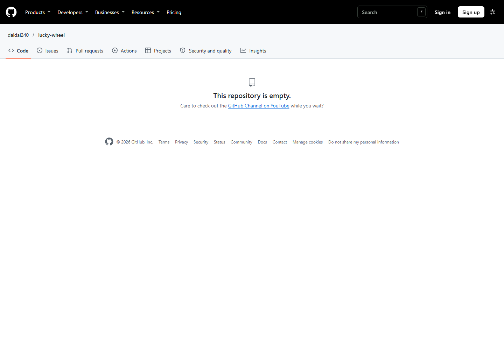
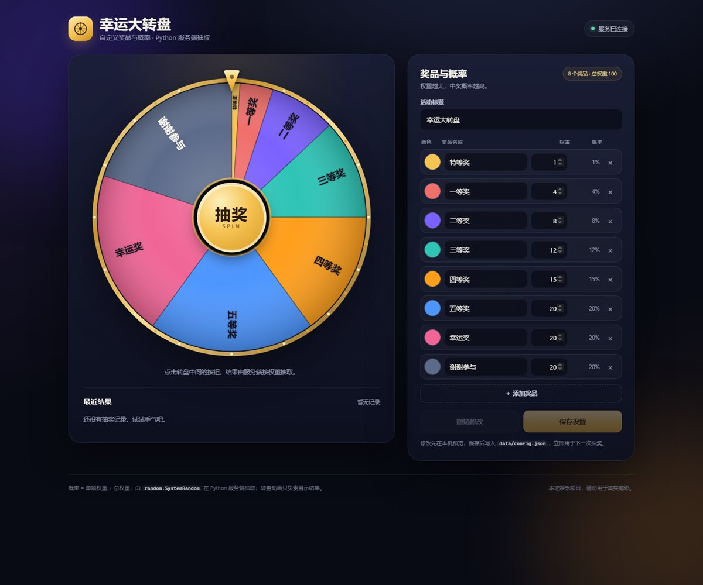
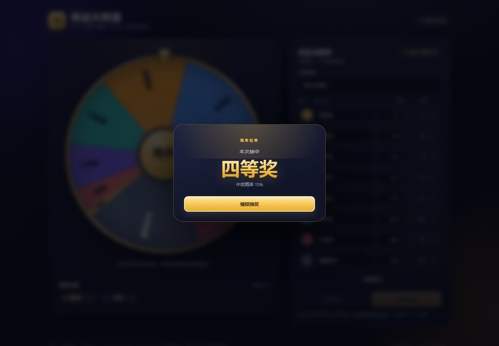
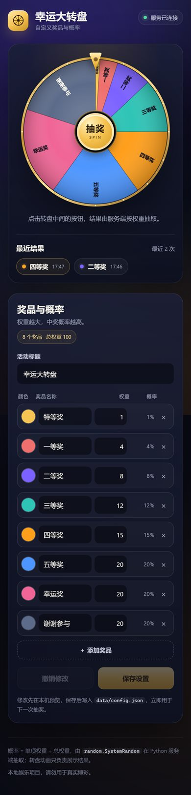

# Lucky Wheel · 幸运大转盘

一个用 Python 写的转盘抽奖网页游戏：奖品名称、颜色和权重都可以在页面上实时编辑，保存后立即生效。抽奖结果由 Python 服务端按权重抽取，前端转盘只负责把结果转出来。

项目不依赖任何第三方包，不需要数据库、Node.js 或构建步骤，Python 3.10+ 即可直接运行。

## 界面

项目从一个空仓库开始。下面是空仓库基线与完成后的界面：

| 之前：空仓库 | 之后：应用界面 |
| --- | --- |
|  |  |

抽奖结果弹窗：



移动端（点击查看大图）：

<a href="docs/screenshots/after-mobile.jpg"></a>

## 功能

- **可视化编辑奖品**：修改名称、颜色和权重，支持 2–24 个奖品。
- **概率实时换算**：每一项都会显示当前中奖概率，权重越高概率越大。
- **服务端公平抽取**：使用 `random.SystemRandom`（操作系统安全随机源）在 Python 端决定结果，前端不能指定或篡改结果。
- **转盘动画对齐结果**：先由服务端抽奖，再由动画转到对应扇区，动画只负责展示。
- **配置持久化**：保存到 `data/config.json`，重启不丢失；配置文件损坏时会自动备份并回退默认配置。
- **最近结果**：服务端保留最近 20 条记录，页面展示最近 8 条（内存保存，重启后清空）。
- **响应式界面**：桌面和手机均可使用，支持键盘操作与减少动画偏好。
- **零外部依赖**：不加载 CDN 资源，自带 CSP 与常用安全响应头。

## 快速开始

```powershell
git clone https://github.com/daidai240/lucky-wheel.git
cd lucky-wheel

# Windows
py app.py

# macOS / Linux
python3 app.py
```

然后打开 <http://127.0.0.1:8000/>。

默认只监听 `127.0.0.1`。可以通过参数或环境变量调整：

```powershell
py app.py --port 9000
py app.py --data-dir ./my-data
py app.py --host 0.0.0.0        # 不建议：会把编辑接口暴露给能访问该端口的人
```

| 参数 | 环境变量 | 默认值 |
| --- | --- | --- |
| `--host` | `WHEEL_HOST` | `127.0.0.1` |
| `--port` | `WHEEL_PORT` | `8000` |
| `--data-dir` | `WHEEL_DATA_DIR` | `./data` |

## 自定义奖品与概率

1. 在右侧「奖品与概率」中修改奖品名称、颜色和权重。
2. 页面会实时重绘转盘并更新每一行的概率。
3. 点击「保存设置」后写入 `data/config.json`，下一次抽奖立即使用新配置。

权重是相对值，概率计算公式为：

```text
单项概率 = 单项权重 ÷ 所有奖品权重之和
```

例如三个奖品权重分别为 `1`、`3`、`6`，中奖概率就是 `10%`、`30%`、`60%`。默认配置的总权重为 `100`，所以权重数字可以直接当作百分比来读。

限制与规则：

- 奖品数量：2–24 个。
- 奖品名称：不超过 24 个字符；活动标题不超过 30 个字符。
- 权重：大于 0 的数字，支持小数；最大 1,000,000。
- 颜色：`#rrggbb` 格式；非法颜色会回退到内置调色板。
- 抽奖时如果存在未保存的修改，会提示先保存，避免转盘扇区和服务端配置不一致。
- 想恢复默认配置，删除 `data/config.json` 后重启服务即可。

`data/config.json` 的结构如下：

```json
{
  "version": 1,
  "title": "幸运大转盘",
  "prizes": [
    { "id": "prize-1", "name": "特等奖", "weight": 1, "color": "#f6c453" },
    { "id": "prize-2", "name": "谢谢参与", "weight": 99, "color": "#5c6b8a" }
  ]
}
```

## 抽取公平性

- 抽奖在服务端 `POST /api/spin` 完成，使用 `random.SystemRandom()` 从操作系统安全随机源取值，再按累计权重落点。
- 前端拿到的响应已经包含结果，动画只是把转盘转到对应扇区；即使修改前端 JavaScript，也不能改变服务端决定的结果。
- 权重只在服务端校验和计算，概率由 `权重 / 总权重` 得出。
- 本项目是娱乐项目，不是经过审计的博彩系统，请勿用于真实金钱或赌博。

## API

| 方法 | 路径 | 说明 |
| --- | --- | --- |
| `GET` | `/api/config` | 读取当前配置，附带每项概率和总权重 |
| `PUT` | `/api/config` | 保存配置，请求体为 `{ "title": "...", "prizes": [...] }` |
| `POST` | `/api/spin` | 按当前配置抽一次奖，返回结果与最近记录 |
| `GET` | `/api/history` | 读取最近 20 条内存中的抽奖记录 |
| `GET` | `/healthz` | 健康检查 |

示例：

```powershell
curl.exe http://127.0.0.1:8000/api/config

curl.exe -X POST http://127.0.0.1:8000/api/spin

curl.exe -X PUT http://127.0.0.1:8000/api/config `
  -H "Content-Type: application/json" `
  -d '{"title":"年会抽奖","prizes":[{"name":"一等奖","weight":1,"color":"#f6c453"},{"name":"谢谢参与","weight":9,"color":"#5c6b8a"}]}'
```

非法配置会返回 `400` 和 `{ "error": "..." }`，不会覆盖已有的有效配置。

## 项目结构

```text
app.py                         启动入口
lottery/model.py               配置校验、概率计算、加权抽取
lottery/store.py               config.json 的原子读写与损坏备份
lottery/server.py              标准库 HTTP 服务、API 与静态资源
lottery/static/index.html      页面结构
lottery/static/styles.css      响应式样式
lottery/static/app.js          转盘绘制、编辑器和动画
tests/                         单元测试与 HTTP 集成测试
docs/screenshots/              界面截图与空仓库基线
```

## 测试

```powershell
py -m unittest discover -s tests -t . -v
```

测试覆盖配置校验、权重分布、JSON 持久化、HTTP API、静态资源与路径穿越防护。权重分布测试使用固定随机种子，不依赖外部服务。

## 安全说明

- 这是一个本地娱乐项目，`PUT /api/config` 没有登录或鉴权；默认只绑定 `127.0.0.1`，请勿直接在公网暴露。
- 页面不加载任何外部资源，并设置了 CSP、`X-Content-Type-Options: nosniff`、`Referrer-Policy: no-referrer` 等响应头。
- 抽奖历史只保存在进程内存中，重启服务后清空。
- 配置写入使用同目录临时文件 + 原子替换，避免写一半导致配置文件损坏。
